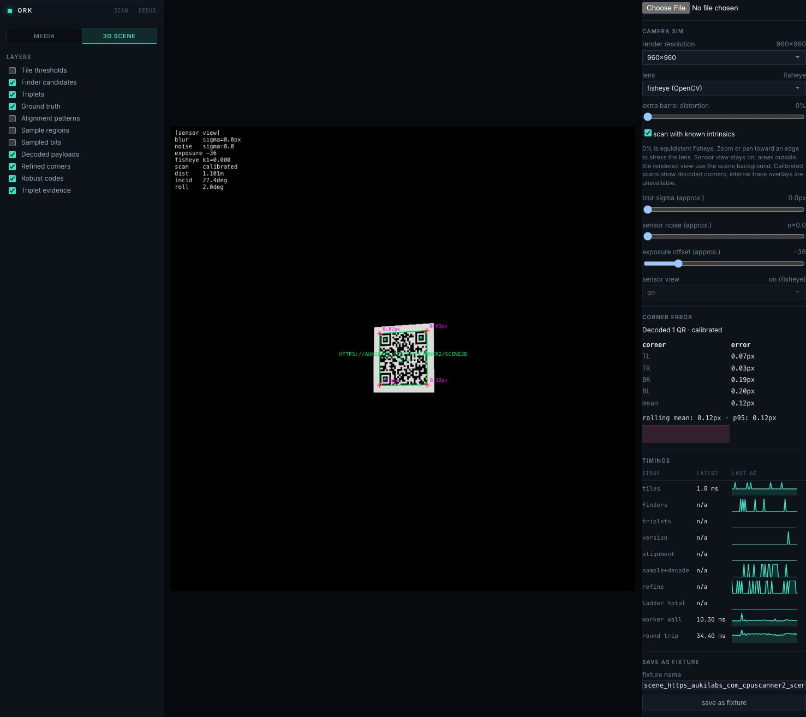

# Scanning with known camera calibration

The Rust `scan_calibrated` function and reusable `CalibratedScanner` decode QR
codes in lens-distorted frames. They accept the camera's intrinsics and lens
model and return the payload and corners in the **original input image**.
QR Lab does not estimate camera pose or infer calibration on this path.

```rust
use qr_lab::image::{Gray8View, Size};
use qr_lab::{
    CalibratedScanner, CameraCalibration, CameraIntrinsics, LensDistortion,
    ScanOptions,
};

// Example values: replace these with calibration for your actual input buffer.
let calibration = CameraCalibration::new(
    Size::new(1280, 720),
    CameraIntrinsics { fx: 600.0, fy: 600.0, cx: 639.5, cy: 359.5 },
    LensDistortion::Fisheye([0.01, -0.002, 0.0, 0.0]),
)?;
let mut scanner = CalibratedScanner::new(calibration, ScanOptions {
    max_working_dim: 960,
    refine: true,
})?;

// For each frame, pass a grayscale/Y plane; padded row strides are supported.
let pixels = vec![255u8; 1280 * 720];
let frame = Gray8View::new(&pixels, 1280, 720, 1280)?;
let result = scanner.scan(&frame)?;
for code in result.codes {
    let corners = code.refined_corners_source.unwrap_or(code.corners_source);
    println!("{}: {:?}", code.payload, corners);
}
```

For one frame, `scan_calibrated(&frame, &options, &calibration)` provides the
same behavior and constructs the map for that call. For video, reuse
`CalibratedScanner` to retain the map and working buffer. It has no temporal
finder pool; each frame is detected independently.

## Calibration contract

- `fx`, `fy`, `cx`, and `cy` are in input pixels, with integer pixel centers
  and zero skew. Focal lengths must be finite and positive.
- `LensDistortion::None` describes a pinhole or already-undistorted image.
- `BrownConrady([k1, k2, p1, p2, k3])` uses the five-coefficient OpenCV
  radial/tangential model. Rational, thin-prism, and tilted-sensor extensions
  are not supported.
- `Fisheye([k1, k2, k3, k4])` uses OpenCV's theta polynomial. Four zero
  coefficients still describe an equidistant fisheye, **not** a pinhole.
- The supplied dimensions and intrinsics must describe the image after any
  resize, crop, or rotation. Dimension mismatches return an error. Changes to
  orientation or cropping with unchanged dimensions cannot be detected by QR Lab;
  the caller must update calibration accordingly. Lens coefficients alone do
  not encode those image transforms.
- Construction checks numeric validity, not whether coefficients describe a
  physically valid, invertible lens throughout the requested field of view.

The virtual rectified image defaults to the same intrinsics and dimensions as
the source. `calibration.with_rectified_intrinsics(...)` selects another virtual
pinhole camera without changing the source calibration. Smaller focal lengths
increase coverage at the expense of working pixels per module. Output coordinates
still refer to the original source. A single rectilinear view cannot represent
a fisheye field of view of 180 degrees or more; this implementation does not yet
scan multiple viewing directions.

Models were checked against the official OpenCV
[camera calibration equations](https://docs.opencv.org/4.x/d9/d0c/group__calib3d.html)
and [fisheye equations](https://docs.opencv.org/4.x/db/d58/group__calib3d__fisheye.html)
on 2026-10-16. Unit tests include independently generated OpenCV 4.12.0 projection
values. No OpenCV runtime dependency is added to Rust.

## Geometry and sampling

1. Build and cache a map from rectified working pixels to original source pixels.
   The map uses eight bytes per working pixel; the grayscale working buffer uses
   one additional byte per pixel.
2. Detect finders, group candidates, and locate timing/version/alignment patterns
   on the rectified working image using the existing scanner pipeline.
3. For every module sample, compose the QR perspective transform, the exact
   per-axis working-to-rectified scale, and the lens projection. Bilinearly sample
   the original image once. Thresholds come from the rectified working image.
4. Refine edges in full-resolution rectified coordinates. Each edge-profile
   sample follows the lens mapping into the original image, so fitting straight
   lines does not mistakenly fit across curved camera-space edges.
5. Map coarse and refined corners into original image pixels. No pose calculation
   is involved. The four points describe the module-region boundary in
   TL/TR/BR/BL QR order; the distorted edges connecting them may be curved.

Missing working-image samples are filled white. Missing source samples are
counted by the decoder's existing out-of-bounds budget, and rejected during
refinement. An undefined projection of a decoded corner returns an error rather
than publishing NaN coordinates. `corner_refined` identifies which of the four
refined corners were fitted and which retained their coarse estimate.

This additive Rust API is the calibrated counterpart of `scan`. The existing
`Scanner`, robust ladder, temporal sessions, and C/Python/mobile entry points
retain their existing behavior. Unknown-calibration recovery and those calibrated
bindings are future work. WASM now exposes `WasmCalibratedScanner`:

```ts
const scanner = new WasmCalibratedScanner(width, height, {
  intrinsics: { fx, fy, cx, cy },
  distortion: { model: "fisheye", coefficients: [k1, k2, k3, k4] },
  // optional: rectified_intrinsics: { fx, fy, cx, cy }
}, maxWorkingDim, true);
try {
  const { detections } = scanner.scan_rgba(rgba);
  // detections.codes[].corners_source / refined_corners_source are sensor pixels.
} finally {
  scanner.free();
}
```

The binding also accepts `model: "none"` (no coefficients) and
`model: "brown_conrady"` with `[k1, k2, p1, p2, k3]`. Dimensions, calibration,
and scan options are fixed per scanner; replace it if they change. The envelope's
`scan_width`/`scan_height` are source dimensions because all returned corners use
source pixels, regardless of the internal working resolution. Calibrated scans
have no diagnostic trace. See the [synthetic fisheye simulator](../../debug-ui/README.md#synthetic-fisheye-camera)
for interactive comparison and fixture export.



## Validation and measurements

The self-contained Rust tests render QR modules directly through an independent
inverse camera model, with 4×4 coverage samples per integer-centered pixel.
They cover perspective, fisheye, barrel/pincushion distortion, inverted and
mirrored codes, multiple codes, alignment regions, non-square downscaling,
custom rectified intrinsics, padded input rows, mismatched calibration dimensions,
and empty detections. The corner accuracy gate is 0.6 source pixels on these
synthetic examples; this is not a real-camera accuracy guarantee.

```bash
cargo test -p qr-lab-qr --release --test calibrated_scan
cargo test -p qr-lab-qr --release --test calibrated_scan calibrated_latency \
  -- --ignored --nocapture --test-threads=1
```

Reference run on an Apple M2 Max, CPU-only release build, 641×479 grayscale input
with stride 648, 420×314 working image, QR version 3, refinement enabled:

| Input model | Ordinary scan p50 / p95 | Calibrated p50 / p95 | Ordinary → calibrated result |
|---|---:|---:|---|
| Pinhole | 0.436 / 0.498 ms | 0.790 / 0.897 ms | Both decode; max corner error ≈0.013 px |
| Equidistant fisheye | 4.928 / 5.291 ms | 0.945 / 1.076 ms | Miss → decode, max corner error 0.028 px |
| Radial `k1=0.18` | 0.582 / 0.665 ms | 0.740 / 0.864 ms | Max corner error 11.316 → 0.252 px |

Each measurement is one frame per call, five warmups followed by 100 alternating
ordinary/calibrated calls timed with `Instant`. Synthetic rendering is excluded.
The cached map's one-time construction cost was 0.61–2.21 ms, excluded from these
per-frame numbers. Projection/refinement math uses `f64`; cached map coordinates
use `f32`; image samples use `u8`. These cases demonstrate behavior, not an estimate
of recall across camera hardware or real-world scenes.

The ordinary scanner was also compared with the pre-change checkout on all 142
generated fixtures (`--config baseline --max-dim 1280 --refine`). Five complete
passes per build, alternating execution order and with no separate warmup, gave
median suite-mean latency 4.074 → 4.058 ms and median suite-p95 latency
6.863 → 6.953 ms. Per-fixture decode and corner-error records were identical,
including 131 decoded codes and zero spurious decodes across the full golden and
degraded set. The ordinary refinement sampler is specialized at compile time
and does not check for a lens model at each profile sample.
