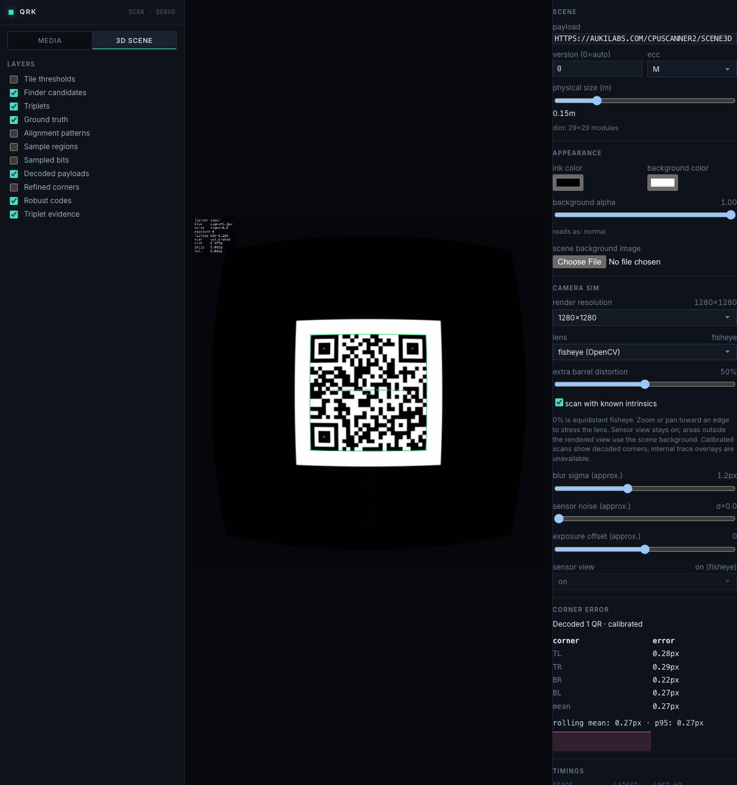
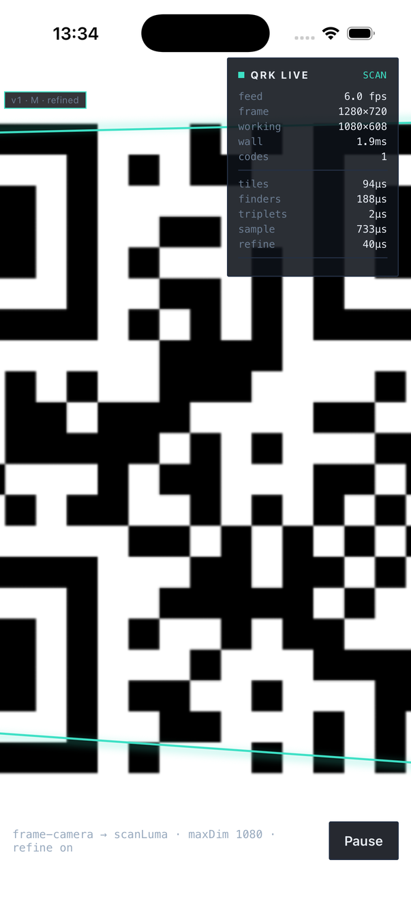
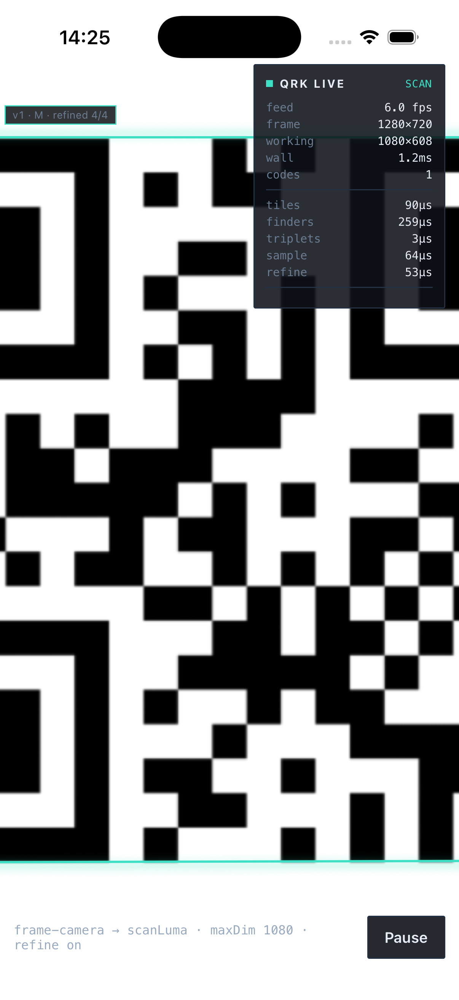

# Rust library review — 2026-11-02

This pass follows the production Rust pipeline, from input buffers to decoded
bytes and refined corners. The implementation lives primarily in `qr-lab-qr`,
`qr-lab-image`, `qr-lab-imgproc`, and `qr-lab-geometry`; `qr-lab-core` is the
compatibility facade. The separate [simulator review](review-2026-11-02.md)
covers the earlier browser/Expo changes.

Baseline: Rust sources at `276b7a6`. Measurements used release builds on an
Apple M2 Max. Baseline executables were saved before changing the core.

**Screenshot correction:** the original iOS screenshot proved binary payload
preservation, but showed a real corner-localization defect. The follow-up below
fixes the large-finder cause and records measured before/after geometry. The
original image is retained as failing evidence, not a corner-accuracy success.

## Pipeline review

| Step | Inspection and outcome | Evidence |
|---|---|---|
| 1. Image input and views | Checked dimensions, strides, last-row buffer requirements, ROI bounds, RGB conversion, and checked arithmetic. Kept the existing validated views. | Image tests pass; the new binary scan test uses padded rows. Native checks also cover invalid dimensions and an unpadded final row. |
| 2. Working resolution and coordinates | Followed downscaling and source-resolution sampling. Internals already use separate X/Y scale factors; the public `source_scale` remains the documented width-based approximation. | Existing downscale/source-sampling gates pass. Classic decoded outputs, including all corners, match the baseline on all 142 generated fixtures. |
| 3. Thresholds | Fixed overflow in public tile-threshold offsets and oversized Sauvola radii. Addition now widens before clamping; window endpoints use saturating arithmetic. | Reproduced debug panics before the fixes. New tests cover both tile methods, both extreme `i16` offsets, and `usize::MAX` radius. |
| 4. Finder detection | Identified row run-length encoding as work inside the dominant stage. Accumulate the current run in local variables and write scratch storage once per run. The screenshot follow-up also preserves run polarity across low-contrast interiors during cross-checks and dense-row binarization. | Finder gates and a 256-case size/offset/polarity sweep pass. The generated suite has one extra unused finder candidate; decoded classic geometry is unchanged. |
| 5. Triplet grouping | Reviewed geometric checks, compatibility graph, ordering, and overlap handling. The existing graph already prunes larger candidate sets; measured grouping is only about 2 µs per fixture on average. The screenshot follow-up prevents flat interiors from advancing the black/white/black measurement state. | Triplet tests and classic decoded-output comparison pass. |
| 6. Version, alignment, and sampling | Followed timing/version evidence, homographies, alignment anchors, source sampling, and retry/arbitration paths. Kept current algorithms. | Existing gates cover all QR versions, transforms, mirrored matrices, high-version alignment, and perturbed geometry. |
| 7. Payload decoding | Fixed rejection of valid non-UTF-8 QR content. `decode_bits` now uses `rqrr::Grid::decode_to` into private byte storage. `payload_bytes` is lossless; `payload` is lossy UTF-8 display text. Failed partial output cannot escape as a successful decode. Robust deduplication already compares bytes. | New normal/transposed bit-matrix tests failed before the fix. The same binary payload passes classic, robust, temporal/reset, calibrated, WASM-worker, and native scans. |
| 8. Corner refinement | Replaced three small heap-backed profile buffers with fixed seven-element stack arrays, preserving arithmetic order. | Synthetic accuracy gates pass; every classic coarse/refined corner matches exactly across 142 fixtures. Repeated stage measurements show approximately 37% lower refinement time. |
| 9. Robust image recovery | Found border erosion/dilation windows including pixels outside the requested window. Corrected both the public operators and the internal kernel used by shadow normalization. Reviewed illumination, sharpening, blur/deblur, and ladder scheduling. | An independent brute-force min/max reference exposed the bug. Tests now cover borders, one-pixel dimensions, kernels larger than the image, and both extrema. Robust decode results are unchanged across 142 fixtures. |
| 10. Sessions, calibration, and bindings | Followed pooled finder evidence, reset behavior, calibration-map reuse, result conversion, C serialization, and WASM/native entry points. Rust/WASM schemas and C symbols remain unchanged; native JSON now additionally exposes `cornerRefined`, optional in Expo types for older binaries. | Four binary session frames plus reset pass; calibrated tests pass; dependency/feature and ABI checks pass; rebuilt browser and iOS integrations preserve exact bytes. |

The upstream distinction between UTF-8 `decode` and byte-oriented `decode_to`
was checked against the installed rqrr 0.10.1 implementation and its
[official API documentation](https://docs.rs/rqrr/0.10.1/rqrr/struct.Grid.html#method.decode_to).
No decoder dependency upgrade or detection-tolerance tuning was needed.

## Quality comparison

The fixture suite contains 142 images, 154 labeled codes, and 117 codes marked
as expected to decode. Some intentionally difficult codes are not required to
decode, so total decodes can exceed the expected subset.

| Configuration | Expected subset, before → after | Total decodes, before → after | Spurious decodes |
|---|---:|---:|---:|
| Classic baseline | 116/117 → 116/117 | 131 → 131 | 0 → 0 |
| Robust fast | 117/117 → 117/117 | 140 → 141 | 0 → 0 |
| Robust full | 117/117 → 117/117 | 141 → 142 | 0 → 0 |

Classic decoded codes, triplets and corners remain exactly equal after removing
timing fields. Finder output has one additional unused candidate in `ver_00_v1`.
Both robust modes now also decode `occl_01` (an intentionally difficult code
outside the required subset), with 0.30 px mean corner error. All previously
decoded codes retain their payloads and corner-error results.

The earlier morphology correction changes recovery work on `lowres_07`:
eight pooled finders instead of nine and ten variants instead of twelve.
Its decoded result remains the same. Full internal-output parity is not claimed.

The new binary regression uses bytes `00 FF 80 41 C3 28` (Base64 `AP+AQcMo`),
which the previous implementation rejected. It exercises byte zero, invalid
UTF-8, normal/transposed matrices, padded input, downscaling, refinement,
robust scanning, temporal reuse/reset, and calibration.

## Performance evidence and limits

The following initial measurements predate the large-finder screenshot fix.
Five before/after suite pairs alternated execution order. Each suite scanned
all 142 fixtures with `max_working_dim=1280` and refinement enabled. The table
reports the median of the five per-suite mean latencies:

| Configuration | Before | After | Observed reduction |
|---|---:|---:|---:|
| Classic baseline | 4.287 ms | 3.938 ms | 8.1% |
| Robust fast | 7.936 ms | 7.060 ms | 11.0% |
| Robust full | 23.879 ms | 20.367 ms | 14.7% |

These whole-scan improvements are provisional. A second, longer classic
profile used two warmups and eleven repetitions per fixture, across three
alternating before/after pairs. The median of the per-run means was:

| Stage | Before | After | Observed reduction |
|---|---:|---:|---:|
| Whole classic scan | 4144.73 µs | 4134.46 µs | 0.2% |
| Finder detection | 3234.71 µs | 3122.16 µs | 3.5% |
| Corner refinement | 77.35 µs | 49.01 µs | 36.6% |

Whole-scan results varied substantially; background indexing, backup/security
processes, and simulator activity were present on the machine. The strongest
repeatable performance evidence is the refinement improvement, accompanied
by exact output parity. The whole-scan 8–15% figures are observations, not a
general speedup guarantee. No physical-device latency claim is made.

The new [stage profiler](../../crates/qr-lab-bench/src/bin/core_profile.rs)
loads each fixture before timing, records per-stage medians, and saves
deterministic detection output for comparison:

```sh
cargo run --release -p qr-lab-bench --bin core_profile -- 11 core-profile.json
cargo run --release -p qr-lab-bench --bin qr-lab-bench -- \
  --fixtures fixtures --config baseline --config robust-fast \
  --config robust-full --max-dim 1280 --refine --out core-quality.json
```

For a baseline comparison, build the same profiler against the baseline Rust
sources and retain that executable before building the changed library.
The profiler itself is new in this pass. Local raw A/B results are in
`/tmp/qr-lab-core-review`; they are temporary artifacts, not repository inputs.

### Performance recheck after the screenshot fix

Three further alternating release-profile pairs used the same baseline executable,
two warmups and eleven scans per fixture. On the same M2 Max, the median per-run
mean was 4035.49 → 3937.45 µs for the whole classic scan (2.4% lower),
3159.63 → 3047.80 µs for finder detection, and 73.59 → 44.18 µs for refinement.
Triplet measurement rose from 1.51 to 1.66 µs. Background-load caveats still apply;
these results do not establish a reliable general whole-scan speedup. Raw outputs
are `/tmp/qr-corner-perf-{before,after}-{0,1,2}.json`.

## Rebuilt integration verification

- Rebuilt optimized WASM and the debug UI, then loaded the new hashed WASM
  asset in the production browser simulator. At 1280 resolution, 50% fisheye
  distortion, and 1.2 px blur, it decoded one QR with 0.27 px mean corner
  error. Calibration off gave 2.68 px; turning it back on restored 0.27 px.
  These are smoke-test readings, not comparisons with the earlier scene pose.
- Browser worker checks passed for classic/robust/session scans and failure
  handling. The binary payload survived classic and robust worker scans, four
  session frames, reset, and direct calibrated WASM scanning.
- Rebuilt all installed iOS Rust targets and the Expo Xcode app, then installed
  on iPhone 17 Pro / iOS 26.0. Injected the binary QR image with `serve-sim`.
  The initial camera result preserved `payloadBytesB64: "AP+AQcMo"`, but its
  corner coordinates were inaccurate. After the follow-up rebuild, the same
  injected frame preserves the bytes and all four corners pass refinement;
  the maximum error is 0.97 source pixels. Direct rebuilt WASM scanning of
  the captured frame returns the same coordinates.
- Direct native scanning of the padded binary image at a 160-pixel working
  cap preserved the same bytes. All ten existing native invalid-input and
  recovery checks passed. The connected native runtime log registry was empty.
- Generated native archives were used to build the verified app, then restored
  out of the source diff. Rebuild with `scripts/build-native-ios.sh` before
  testing the source changes in another native app.

## Automated checks

| Check | Result |
|---|---|
| `cargo test --workspace --release --no-fail-fast` | 233 passed, 4 failed due to missing photo fixtures, 1 ignored manual benchmark |
| Debug threshold and morphology tests | Passed, including the new overflow and clipped-window regressions |
| `cargo fmt --all --check` | Passed |
| `cargo doc -p qr-lab-qr -p qr-lab-imgproc --no-deps` | Passed |
| `scripts/check-qr-lab-deps.sh` | Passed dependency boundaries and feature combinations |
| `scripts/check-qr-lab-abi.sh` | Passed legacy and operator symbol checks |
| `scripts/check-wasm.sh` | Passed default and `qr-gen` configurations |
| `scripts/build-wasm.sh` | Passed optimized WASM build |
| Debug UI `npm run test:calibrated` | 5 passed against rebuilt WASM |
| Debug UI `npm run build` | Passed TypeScript and production build |
| `scripts/build-native-ios.sh` | Passed device ARM64, simulator ARM64 and x86_64 |
| Expo Xcode simulator build | Passed |

The four unavailable real-photo tests require `fixtures/real/IMG_4832.png`
(two tests), `video_f167.png`, and `real_1.png`; the real-capture gate also
expects `real_2.png` after the first file. No assertions were weakened or
skipped. Generated-fixture parity does not establish real-photo parity.
Android and physical cameras were not exercised. The iOS 27 Expo lifecycle
problem recorded in the earlier simulator review remains outside this pass.

### Simulator screenshots

Production browser simulation with rebuilt WASM, 50% fisheye distortion,
1.2 px blur, and calibrated corner overlays:



### Follow-up: iOS screenshot exposed inaccurate corners

The turquoise quad is supposed to follow the **outer module region** of the
QR code, excluding the white quiet zone. The original screenshot does not
meet that requirement. Aspect-fill explains the cropped left/right sides;
it does not explain the sloping top edge or the bottom edge cutting through
modules. The original evidence caption overstated what had been verified.

The exact 1280×720 camera luminance frame reproduced the same bad corners in
Rust alone, ruling out preview mapping as the cause. Working resolution was
1080×608. Large black finder cores contain entire 48×48 threshold neighborhoods
with no contrast; their local threshold is zero. Treating `pixel < threshold`
as a valid polarity decision there creates white holes inside black finders,
shifts their estimated centers, and corrupts the initial quadrilateral.

Finder cross-checks, dense scan rows and triplet module measurements now
preserve the current run across low-contrast interiors. Actual transitions
still require contrast-bearing samples; geometric acceptance tolerances are
unchanged. The captured frame and a generated 256-case sweep cover sizes
16/20/24/32 pixels per module, both polarities, every tile offset, and versions
1/2. All finder centers and payloads pass; version-1 corners also pass a 2 px
bound. Both committed regression tests fail on the original detector.

Measured source-pixel errors on the captured camera frame:

| Corner | Before | After |
|---|---:|---:|
| Top left | 10.21 px | 0.75 px |
| Top right | 2.17 px | 0.65 px |
| Bottom right | 1.84 px | 0.97 px |
| Bottom left | 39.73 px | 0.84 px |

The reference is the axis-aligned module boundary, within approximately half
a source pixel due to camera resampling. Rust replay, rebuilt WASM and the
rebuilt iOS camera return the same final coordinates and exact binary bytes.

The original result had final-fit flags `[true, true, false, false]`. The C
JSON bridge previously dropped them, so the UI called any non-null corner
array “refined.” It now forwards `cornerRefined`, and the overlay displays
`refined N/4`; older native binaries show “refinement attempted.” These flags
report fit success, not a guarantee of geometric accuracy.

**Before — binary decoding succeeded, corner accuracy failed:**



**After — same injected camera frame, corrected Rust detector and 4/4 fits:**



Regression data and provenance are in
[`large_finders.rs`](../../crates/qr-lab-qr/tests/large_finders.rs) and
[the fixture README](../../crates/qr-lab-qr/tests/data/README.md).
Run `cargo test -p qr-lab-qr --test large_finders --release`.

A broader exploratory sweep still found errors above 2 px on large version-2
codes, despite accurate finder centers and successful decoding. That separate
alignment/refinement limitation remains unresolved; this fix is not a general
corner-accuracy guarantee for higher QR versions.

## Next core priorities

1. Restore the real-photo fixtures and establish a repeatable physical-device
   benchmark before further detector or recovery tuning.
2. Profile retained scratch storage across repeated frames. The reusable
   scanner retains RGB/calibration storage, while substantial pipeline scratch
   still lives within a frame. Measure allocation counts and peak retained
   memory before expanding ownership or changing APIs.
3. Reduce duplicated public/internal image kernels where their contracts
   match. This review had to fix morphology in both places. Keep independent
   pixel-reference tests and robust recall comparisons when consolidating.

This is a staged source and behavioral review of the production paths, not an
exhaustive proof for arbitrary images or every possible configuration.
