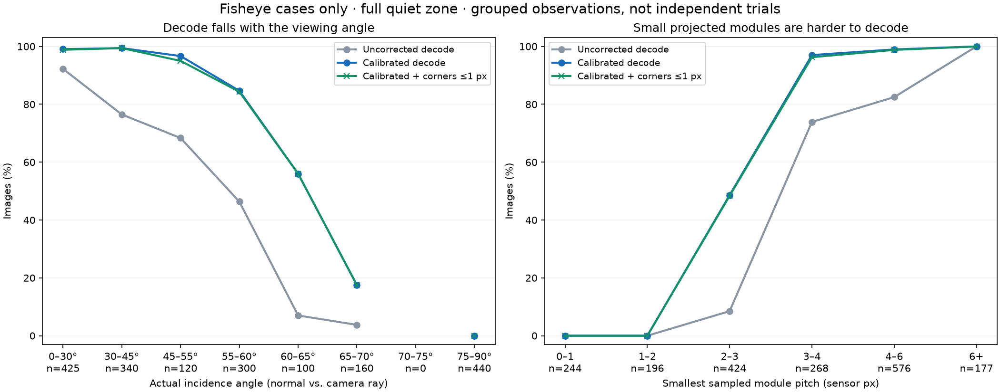

# Fisheye stress test — 2026-10-16

Known calibration largely removes the extra penalty from lens distortion in
this synthetic scene. The remaining limits are steep-angle detection/grouping,
small projected modules, and occasional inaccurate corners despite a correct
decode. This tests QR decoding and image-space corners, not pose estimation.



## Evidence

The primary run contains **4,950 images / 9,900 scans**, at 640×640 with 4×4
source supersampling. It compares the actual compiled WASM scanner with and
without calibration, using the simulator's actual fisheye warp. A deterministic
analytic plane renderer supplies the source image and independent geometric
corner truth; it does not capture the WebGL UI.

- Pinhole control plus fisheye strengths 0, 0.25, 0.5, 0.75, 1. The coefficient
  mapping is `k1 = -0.5 * strength`, with the other three coefficients zero.
  Strength 0 is still equidistant fisheye, not pinhole.
- Plane tilts 0°, 20°, 40°, 55°, 65°, 75°, 82° in four directions.
- Center, four edges, four corners; quiet-zone margins 32, 4, −8 and −32 pixels
  in the source image. Negative margins deliberately introduce clipping.
- Version 3 QR, ECC M, one fixed payload, nominal frontal width 224 px, 50°
  source field of view, no noise or blur, full-resolution scanning and corner
  refinement enabled.
- Results below use the 1,885 front-facing **fisheye** images with the entire
  quiet zone visible, unless stated otherwise. Rates describe this stress grid,
  not a distribution of real camera inputs.

The [full generated report](../../target/fisheye-sweep-ss4/report.md) includes
per-strength, tilt, position, module-size and clipping tables, heatmaps and
diagnostic crops. [CSV](../../target/fisheye-sweep-ss4/cases.csv),
[JSONL](../../target/fisheye-sweep-ss4/cases.jsonl), and
[metadata](../../target/fisheye-sweep-ss4/metadata.json) preserve every result.
These generated files live in ignored `target/`; the scripts below reproduce
them. Metadata includes the exact WASM and renderer hashes because this run
used the working-tree calibrated implementation, not just the recorded HEAD.

Supplementary data (each directory also contains its parameters in `metadata.json`):

- [Initial 2×2 sweep](../../target/fisheye-sweep-2026-10-16/cases.csv): 4,950 images.
- [1280-pixel sweep](../../target/fisheye-sweep-1280/cases.csv): 1,632 images.
- Centered angular sweeps at [640](../../target/fisheye-sweep-angle640/cases.csv)
  and [1280](../../target/fisheye-sweep-angle1280/cases.csv): 168 images each.
- 640-pixel sampling rechecks at phase
  [0](../../target/fisheye-sweep-recheck-ss4/cases.csv),
  [0.37](../../target/fisheye-sweep-recheck-phase037/cases.csv) and
  [0.73](../../target/fisheye-sweep-recheck-phase073/cases.csv): 200 images each.
- 1280-pixel outlier rechecks at phase
  [0](../../target/fisheye-sweep-1280-recheck/cases.csv) and
  [0.37](../../target/fisheye-sweep-1280-phase037/cases.csv): 24 images each.

## Distortion strength

Across the full clean fisheye grid, calibration increased correct decoding
from **886/1,885 (47.0%) to 1,213/1,885 (64.4%)**. For each strength the same
377 poses were tested:

| Extra strength | Without calibration | With calibration |
|---|---:|---:|
| 0 | 61.0% | 64.7% |
| 0.25 | 55.7% | 64.5% |
| 0.5 | 50.1% | 63.9% |
| 0.75 | 40.8% | 63.9% |
| 1 | 27.3% | 64.7% |

The calibrated rate stays close to the pinhole control's 65.3%; the many
deliberately difficult steep-angle cases limit all of them. This supports the
known-intrinsics correction for this model and field of view, rather than
establishing a universal maximum supported fisheye strength.

## Where decoding breaks down

Position changes the angle between the QR normal and the camera ray. A plane
tilt of 40° near an edge can have an actual viewing angle near 60°. Pooling by
the actual incidence angle makes the limit clearer:

| Actual viewing angle | Calibrated decodes |
|---|---:|
| 0–30° | 421/425 (99.1%) |
| 30–45° | 338/340 (99.4%) |
| 45–55° | 116/120 (96.7%) |
| 55–60° | 254/300 (84.7%) |
| 60–65° | 56/100 (56.0%) |
| 65–70° | 28/160 (17.5%) |
| 75–90° | 0/440 |

There were no samples in the 70–75° bin. Each range includes its lower bound
and excludes its upper bound. These angles are not hard thresholds: raster
sampling, module size and the orientation of the finder patterns also matter.

Two additional centered sweeps tested 50–76° in 2° steps, at **640 and 1280
pixels**, using strengths 0, 0.5, 1 and four tilt directions (12 images per
angle per resolution). The main transition was **58–64°**, with no successful
decodes at **66° or higher** at either resolution. Isolated earlier misses
occurred at 52°/640 and 56°/1280. At 58–62°, only 6/12 decoded at either
resolution; at 64°, 3/12 decoded at 640 and 6/12 at 1280.

Diagnostic scans of centered **pinhole** controls at 1280 showed all three
finders but **zero candidate triplets** at 60° and 62° in one tilt direction.
The opposite direction decoded at both angles. At 65° these directions found
only one or two finders. Doubling resolution therefore does not remove the
limit: detection/grouping also fails before lens correction or payload
decoding can help. Trace results are saved in
[`pinhole-traces.json`](../../target/fisheye-sweep-1280/pinhole-traces.json).

Module size is another useful slice: no clean fisheye case with a smallest
sampled pitch below 2 px decoded (0/440); 2–3 px decoded 206/424 (48.6%),
3–4 px decoded 260/268 (97.0%), and ≥6 px decoded 177/177. These are correlated
with viewing angle, not an independent module-size experiment.

## Where corner accuracy breaks down

Errors are measured in the original distorted sensor pixels, matching the
scanner's API. Each image's error is its **worst of four returned corners**;
the p95 below is conditional on a correct decode. Missing decodes never count
as zero error.

- Calibrated p95: **0.196 px**, compared with **7.073 px** without calibration.
- **1,209/1,213 successful calibrated decodes (99.7%)** had every corner within
  1 px. Including decoding failures, the combined success rate is 64.1%.
- Four clean calibrated images exceeded 1 px. The worst was **2.656 px**:
  `case_01004`, strength 0.25, tilt 40°, left edge, 4 px quiet-zone margin.
- Another moderate-angle outlier, `case_01022`, had **2.421 px** error at
  strength 0.25, tilt 40°, right edge, margin 32. Shifting the source placement
  by 0.37 px reduced it to 0.075 px, and 0.73 px reduced it to 0.108 px.
  All four corners were marked refined in the original inaccurate result.
- A 1,632-image 1280-pixel follow-up found a **6.614 px** error at tilt 70°,
  top-right, 8 px margin, strength 0 (`case_01341`). Increasing source
  supersampling from 2×2 to 4×4 still gave **4.915 px**. A 0.37 px placement
  shift reduced that to 0.645 px. This is a real sensitivity of the pipeline
  to sampled input, not a repeatable physical-angle cutoff.

The initial 2×2 full sweep and three 200-image sampling rechecks also changed
some moderate-angle decode outcomes. Do not treat one raster phase as a
guarantee. A successful payload and `corner_refined = true` are insufficient
to guarantee a particular corner tolerance.

Clipping makes accuracy less reliable. With the QR modules intact but the
quiet zone clipped, calibrated decoded cases had a p95 worst-corner error of
**1.471 px**, reaching **5.257 px**. Cases with clipped QR modules decoded only
40/400. These groups have different pose mixes; their aggregate rates cannot
measure the causal effect of clipping alone.

## Edge coverage and validation limits

The present simulator distorts a **50° pinhole render inward**. With the full
quiet zone intact, its closest sensor-border margin was about **23.9 px** at
strength 0 and **51.4 px** at strength 1. This does test off-axis curvature
and source-edge placement, but **not the outermost field of view of a true
wide-angle fisheye camera**. That needs a wider source render or direct
fisheye ray rendering before extending the edge coverage claim.

Ground-truth lens projection was checked independently against
[`cv2.fisheye.distortPoints`](https://docs.opencv.org/4.x/db/d58/group__calib3d__fisheye.html)
for **16,500 points**; the maximum coordinate discrepancy was
**1.14×10⁻¹³ px**. This checks the mapping convention, not camera realism.
The renderer also has six geometry/raster tests; all **408 UI unit tests**
passed. The benchmark TypeScript type-check and npm entry-point smoke run
passed. Real-camera noise, blur, imperfect calibration, other QR versions,
payloads and truly wide sensor edges remain outside this run.

## Reproduce and investigate

From `debug-ui`, with dependencies installed and the WASM built:

```sh
npm run bench:fisheye -- --out ../target/fisheye-sweep-ss4 --samples 4
python scripts/analyze-fisheye-sweep.py ../target/fisheye-sweep-ss4 --verify-opencv
```

The analyzer needs `matplotlib`; the optional projection check also needs
`opencv-python`. The repo's fixture Python environment was used for this run.
The Node benchmark uses `node:zlib.crc32` (Node 22.15+; tested on 26.3.1).

Examples of focused runs:

```sh
# Centered angular boundary; repeat with --resolution 1280.
npm run bench:fisheye -- --out ../target/fisheye-sweep-angle640 --positions center --tilts 50,52,54,56,58,60,62,64,66,68,70,72,74,76 --strengths 0,0.5,1

# Reproduce the moderate-angle inaccurate-corner case; repeat with --phase 0.37.
npm run bench:fisheye -- --out ../target/fisheye-corner-repro --tilts 40 --azimuths 0 --positions right --margins 32 --strengths 0.25
```

The next useful fixes are to inspect steep-angle finder grouping, reject or
improve inaccurate corner fits on the saved outliers, and extend synthetic
rendering to cover real fisheye sensor edges. The sweep itself does not change
scanner behavior.
